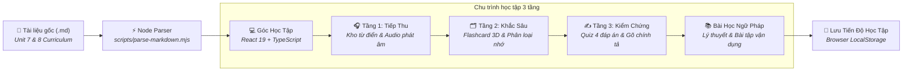
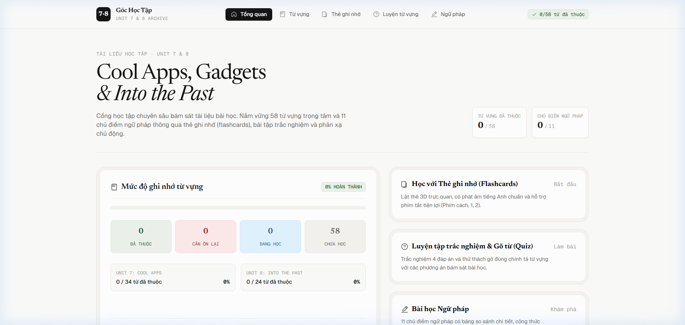
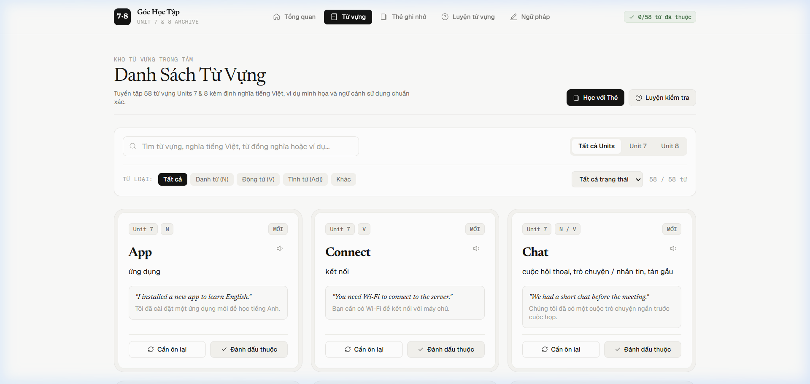
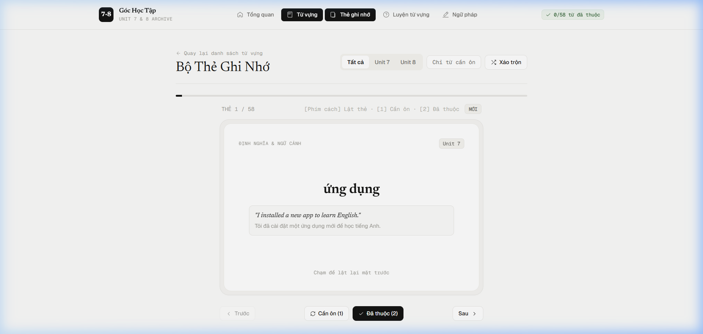
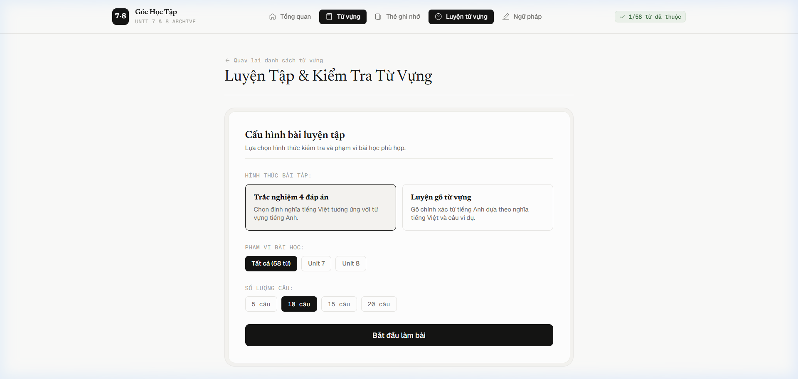
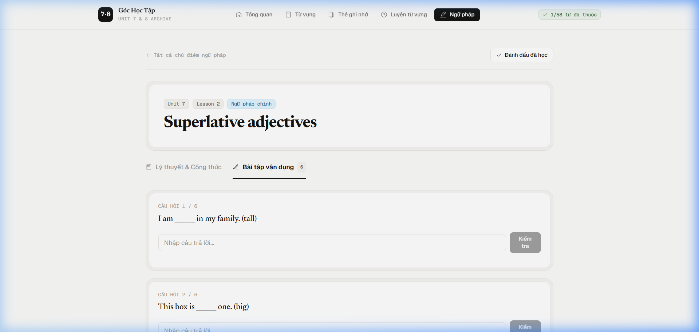
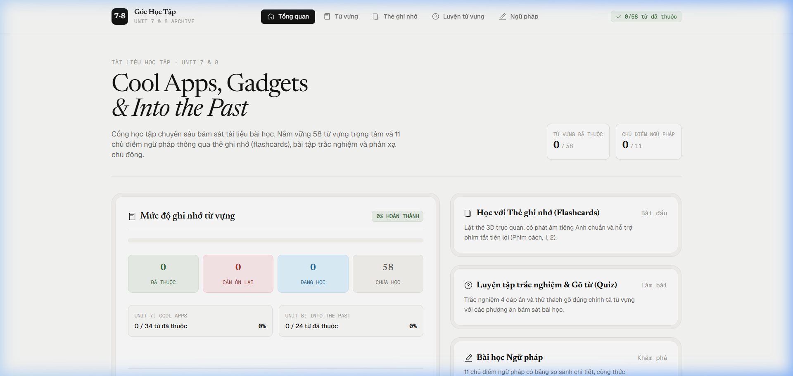

<p align="center">
  
</p>

<p align="center">
  
  
  
  
  
  
</p>

<div align="center">
  <a href="#-ứng-dụng-này-được-sinh-ra-để-làm-gì">🎯 Mục Đích Ra Đời</a> •
  <a href="#-quy-trình-học-tập-3-tầng-pedagogical-cycle">🔄 Quy Trình Học Tập</a> •
  <a href="#-hệ-thống-giao-diện-web-có-những-gì">🎨 Giao Diện &amp; Tính Năng</a> •
  <a href="#-tương-thích-đa-thiết-bị-mobile-first">📱 Trải Nghiệm Di Động</a> •
  <a href="#-hướng-dẫn-cài-đặt--vận-hành">🚀 Cài Đặt &amp; Chạy</a>
</div>

<br />

---

## 🎯 Ứng Dụng Này Được Sinh Ra Để Làm Gì?

Học sinh khi học ngoại ngữ tại trường thường đối mặt với **3 rào cản lớn**:
1. **Tài liệu rời rạc, thiếu tính tương tác**: Việc đọc danh sách từ vựng trên file Word/PDF truyền thống mang tính thụ động, khiến học sinh nhanh quên và khó tạo phản xạ nhớ từ.
2. **Rào cản từ ngữ công cụ**: Nhiều nền tảng ôn tập quốc tế sử dụng 100% tiếng Anh cho toàn bộ giao diện với các thuật ngữ khó, gây bối rối và làm giảm hứng thú của học sinh chưa vững ngữ pháp.
3. **Thiếu cơ chế ghi nhớ chủ động (Active Recall)**: Xem lướt qua từ vựng không thể khắc sâu vào trí nhớ dài hạn nếu thiếu các hoạt động lật thẻ, tự tư duy nghĩa và gõ lại đúng từng ký tự chính tả.

### 🌟 Sứ mệnh & Giá trị cốt lõi:
- 📌 **Bám sát 100% giáo trình (Grounding Truth)**: Toàn bộ 58 từ vựng và 11 chủ điểm ngữ pháp trong Unit 7 (*Cool Apps and Gadgets*) & Unit 8 (*Into the Past*) được trích xuất nguyên bản từ tài liệu của giáo viên. Tuyệt đối không sinh từ ngẫu nhiên, không thêm bớt quy tắc sai lệch ngữ cảnh.
- 🇻🇳 **Giao diện tiếng Việt gần gũi, truyền cảm hứng**: Mọi hướng dẫn, nhãn tính năng, gợi ý phím tắt và lời giải thích đều được chuyển ngữ tự nhiên sang tiếng Việt, giúp học sinh tập trung 100% tâm trí vào bài học.
- ⚡ **Tiện lợi tức thì & Không quảng cáo (Offline-First)**: Không cần đăng ký tài khoản, không bắt buộc kết nối server ngoại vi, lưu trữ tiến độ trực tiếp trên trình duyệt máy tính/điện thoại qua `localStorage`.

---

## 🔄 Quy Trình Học Tập 3 Tầng (Pedagogical Cycle)

Ứng dụng kết hợp phương pháp **Lặp lại ngắt quãng (Spaced Repetition)** và **Gợi nhớ chủ động (Active Recall)** thông qua chu trình khép kín:



---

## 🎨 Hệ Thống Giao Diện Web Có Những Gì?

Thiết kế giao diện tuân thủ triết lý **Warm Monochrome & Editorial Serif**: tông nền ngà `#FBFBFA` êm dịu, tương phản sắc nét với màu chữ than `#141413`, sử dụng font chữ báo chí **Newsreader** kết hợp font hiện đại **Geist**, tạo cảm giác tập trung như đang đọc một cuốn cẩm nang học thuật đắt giá.

---

### 1. 📊 Bảng Điều Khiển Bento (Asymmetrical Dashboard)
Bố cục bất đối xứng hiện đại cung cấp bức tranh tổng thể về quá trình học tập:

<p align="center">
  
</p>

- **Đồng hồ số liệu học tập**: Thống kê số từ đã thuộc (`/58 từ`) và chủ điểm ngữ pháp đã học (`/11 bài`).
- **Thanh đo mức độ ghi nhớ 4 tầng**: 
  - 🟢 **Đã thuộc**: Từ vựng đã nắm vững kiến thức.
  - 🔴 **Cần ôn lại**: Từ vựng đánh dấu cần luyện thêm.
  - 🔵 **Đang học**: Từ vựng đã tương tác qua thẻ hoặc bài kiểm tra.
  - ⚪ **Chưa học**: Từ vựng mới tinh chưa xem qua.
- **Tiến độ từng Unit**: Báo cáo chi tiết % hoàn thành của Unit 7 và Unit 8.
- **Tính năng Đặt lại tiến độ**: Hộp thoại xác nhận an toàn giúp học sinh xóa toàn bộ dữ liệu để ôn lại từ đầu khi chuẩn bị thi cử.

---

### 2. 📖 Kho Từ Vựng Trọng Tâm (Vocabulary Archive & Filter Hub)
Kho từ điển mini thông minh tra cứu 58 từ vựng với tốc độ tức thì:

<p align="center">
  
</p>

- **Tìm kiếm trực tiếp (Live Search)**: Tìm cùng lúc theo từ tiếng Anh, nghĩa tiếng Việt, từ đồng nghĩa hoặc câu ví dụ.
- **Bộ lọc đa chiều tiện dụng**:
  - *Theo Unit*: Tất cả | Unit 7 | Unit 8.
  - *Theo Từ loại*: Tất cả | Danh từ (N) | Động từ (V) | Tính từ (Adj) | Khác.
  - *Theo Trạng thái*: Tất cả | Đã thuộc | Cần ôn lại | Đang học | Chưa học.
- **Thẻ từ vựng cấu trúc viền kép ([VocabCard.tsx](file:///client/src/components/vocabulary/VocabCard.tsx))**:
  - Nút loa nghe phát âm bản xứ (Web Speech API).
  - Huy hiệu phân loại từ và từ đồng nghĩa (`=repair`).
  - Khung câu ví dụ song ngữ chuẩn ngữ cảnh.
  - Khung lưu ý đặc biệt giải thích cách dùng từ dễ nhầm lẫn (ví dụ: *border* vs *boundary*).
  - Nút bấm nhanh **"Cần ôn lại"** và **"Đánh dấu thuộc"**.

---

### 3. 🗂️ Trình Thẻ Ghi Nhớ 3D (Interactive 3D Flashcards)
Giao diện lật thẻ 3 chiều mô phỏng thẻ học thực tế giúp kích thích phản xạ thị giác:

<p align="center">
  
</p>

- **Cấu trúc 2 mặt trực quan**:
  - *Mặt trước*: Từ tiếng Anh khổ lớn, loại từ, nút phát âm và hướng dẫn lật thẻ.
  - *Mặt sau*: Nghĩa tiếng Việt in đậm, câu ví dụ bài học và các lưu ý ngữ pháp quan trọng.
- **Hệ thống phím tắt & Thao tác cảm ứng**:
  | Thao Tác | Phím Tắt (PC / Laptop) | Cử Chỉ Cảm Ứng (Điện Thoại / iPad) |
  |---|---|---|
  | **Lật xem mặt sau / trước** | <kbd>Space</kbd> hoặc <kbd>Enter</kbd> | Chạm trực tiếp vào bất kỳ điểm nào trên thẻ |
  | **Đánh dấu Cần ôn lại** | <kbd>1</kbd> | Chạm nút đỏ **"Cần ôn (1)"** |
  | **Đánh dấu Đã thuộc** | <kbd>2</kbd> | Chạm nút xanh **"Đã thuộc (2)"** |
  | **Chuyển thẻ Trước / Sau** | <kbd>←</kbd> / <kbd>→</kbd> | Chạm nút điều hướng ở thanh dưới |
- **Bộ lọc thẻ nâng cao**: Nút *Chỉ từ cần ôn* giúp học sinh tập trung rèn luyện các từ còn yếu; nút *Xáo trộn (Shuffle)* đảo ngẫu nhiên vị trí thẻ.
- **Ăn mừng hoàn thành**: Bắn pháo hoa ăn mừng khi học sinh xem hết bộ thẻ.

---

### 4. ✍️ Phòng Luyện Tập & Đánh Giá Phản Xạ (Active Recall Quiz)
Môi trường tự kiểm tra kiến thức không áp lực với phản hồi tức thì:

<p align="center">
  
</p>

- **2 Định dạng bài tập chuyên sâu**:
  1. **Trắc nghiệm 4 đáp án**: Chọn định nghĩa tiếng Việt đúng; đáp án nhiễu được thuật toán chọn ngẫu nhiên từ chính các từ vựng cùng chương trình học.
  2. **Thử thách gõ chính tả (Spelling Challenge)**: Đọc nghĩa tiếng Việt và câu văn khuyết từ, học sinh tự gõ từ tiếng Anh để rèn luyện trí nhớ cơ bắp và tránh lỗi chính tả.
- **Tùy biến linh hoạt**: Tự chọn phạm vi Unit và số lượng câu hỏi (5, 10, 15, hoặc 20 câu).
- **Phản hồi tức thì**: Báo đúng/sai ngay lập tức, hiển thị đáp án mẫu nếu trả lời chưa chính xác và tự động tích lũy điểm vào tiến độ tổng thể.

---

### 5. 📚 Trung Tâm Ngữ Pháp & Bài Tập Thực Hành (Grammar Hub)
Kho tàng 11 chủ điểm ngữ pháp được thiết kế thành giáo trình điện tử có cấu trúc:

<p align="center">
  
</p>

- **Danh sách 11 chủ điểm bài học**:
  - *Unit 7*: Superlative Adjectives, Future with *will* vs. *be going to*, Requests with *Can/Could/Will/Would*, Modals of ability (*can/could/be able to*), Speaking strategies, Reading strategies.
  - *Unit 8*: Present Perfect with *ever/never*, Present Perfect with *for/since*, *There was/were* & *There has/have been*, WH-Questions in the Past, Likes and Dislikes with Gerunds/Infinitives.
- **Thiết kế 2 Tab chuyên nghiệp**:
  - **Tab 1: Lý thuyết & Công thức**: Bảng so sánh ma trận đối chiếu, công thức chuẩn, các trường hợp ngoại lệ và danh sách ví dụ trích xuất nguyên bản từ bài học.
  - **Tab 2: Bài tập vận dụng**: Các bài tập trắc nghiệm và điền từ được xây dựng trực tiếp từ câu bài tập trong tài liệu gốc. Có chấm điểm tự động kèm trích dẫn câu gốc để đối chiếu ngay sau khi làm.

---

## 📱 Tương Thích Đa Thiết Bị (Mobile-First)

Ứng dụng được thiết kế tỉ mỉ theo chuẩn **Responsive & Touch-Friendly** dành cho học sinh học trên điện thoại hoặc máy tính bảng:

<p align="center">
  
</p>

- **Vùng chạm ngón tay thoải mái (Touch Targets $\ge 42\text{px}$)**: Các nút bấm, thẻ lựa chọn và ô nhập liệu đều có chiều cao tiêu chuẩn, chống bấm nhầm trên màn hình cảm ứng.
- **Menu Ngăn Kéo (Mobile Drawer)**: Tự động thu gọn thanh menu thành nút mở ngăn kéo mượt mà trên màn hình nhỏ.
- **Bảng ngữ pháp cuộn ngang êm ái**: Bảng so sánh không bao giờ bị ép méo chữ trên màn hình hẹp nhờ cơ chế cuộn thông minh (`min-w-[320px]`).

---

<details>
<summary><b>🛠️ Công Nghệ &amp; Tiêu Chuẩn Lập Trình (Bấm để xem chi tiết)</b></summary>

<br />

- **Framework**: [React 19](https://react.dev/) + [TypeScript 5.7](https://www.typescriptlang.org/) (Strict mode, zero `any`, ưu tiên `interface`).
- **Build Tool**: [Vite 6](https://vitejs.dev/) khởi động trong mili-giây, Hot Module Replacement (HMR) tức thì.
- **Styling**: [Tailwind CSS 3.4](https://tailwindcss.com/) với hệ thống design tokens tùy biến (Warm monochrome, spot pastels, concentric double-bezel).
- **Bộ Icon SVG nội bộ**: Viết trực tiếp trong [Icons.tsx](file:///client/src/components/ui/Icons.tsx) với nét vẽ 1.35px siêu nhẹ, loại bỏ hoàn toàn các thư viện icon nặng nề bên ngoài.
- **Bảo mật tuyệt đối Zero-XSS**: Không dùng `dangerouslySetInnerHTML`. Thành phần [FormattedText.tsx](file:///client/src/components/ui/FormattedText.tsx) phân tích Markdown inline an toàn thành cây React Element (`<strong>`, `<em>`).
- **Biên dịch Markdown tự động**: Kịch bản [scripts/parse-markdown.mjs](file:///scripts/parse-markdown.mjs) chuyển đổi dữ liệu `.md` thành JSON tại thời điểm build.

</details>

<details>
<summary><b>🚀 Hướng Dẫn Cài Đặt &amp; Khởi Chạy Dự Án (Bấm để xem chi tiết)</b></summary>

<br />

### Yêu cầu môi trường:
- **Node.js**: Phiên bản 18 trở lên.
- **npm**: Phiên bản 9 trở lên.

### 1. Cài đặt các gói phụ thuộc:
```bash
npm --prefix client install
```

### 2. Khởi chạy máy chủ phát triển (Development):
```bash
npm run dev
```
Lệnh này sẽ tự động chạy parser trích xuất dữ liệu từ Markdown và mở máy chủ tại `http://localhost:5173`.

### 3. Đóng gói bản phát hành (Production Build):
```bash
npm run build
```
Kiểm tra bản build sản phẩm với lệnh:
```bash
npm run preview
```

</details>

<details>
<summary><b>📝 Hướng Dẫn Thêm Hoặc Sửa Nội Dung Bài Học (Bấm để xem chi tiết)</b></summary>

<br />

Toàn bộ nội dung học tập được điều khiển độc quyền bởi 2 file Markdown ở thư mục gốc. Bạn không cần sửa đổi bất kỳ dòng code React hay TypeScript nào:

1. **Thêm hoặc sửa Từ vựng**:
   - Mở file [`Vocabulary_Units_7_8.md`](file:///Vocabulary_Units_7_8.md).
   - Viết theo định dạng chuẩn:
     ```markdown
     - **Từ_Mới** (POS) (=synonym): Định nghĩa tiếng Việt
       *Ex: Câu ví dụ tiếng Anh. (Dịch nghĩa tiếng Việt.)*
     ```
   - Thêm lưu ý ngữ cảnh:
     ```markdown
     > **Lưu ý:** Nội dung giải thích cách dùng từ...
     ```

2. **Thêm hoặc sửa Ngữ pháp**:
   - Mở file [`Grammar_Summary_Units_7_8.md`](file:///Grammar_Summary_Units_7_8.md).
   - Thêm tiêu đề bài (`### Tiêu đề`), bảng công thức (`| Cột 1 | Cột 2 |`), hoặc danh sách ví dụ.

3. **Đồng bộ dữ liệu vào website**:
   - Chạy lệnh:
     ```bash
     npm run parse
     ```
   - Dữ liệu sẽ tự động chuyển thành JSON trong `client/src/data/` và hiển thị ngay trên web.

</details>

---

<p align="center">
  <sub>Xây dựng với niềm đam mê dành cho giáo dục ngôn ngữ · Toàn bộ bản quyền nội dung thuộc về giáo trình Units 7 &amp; 8</sub>
</p>