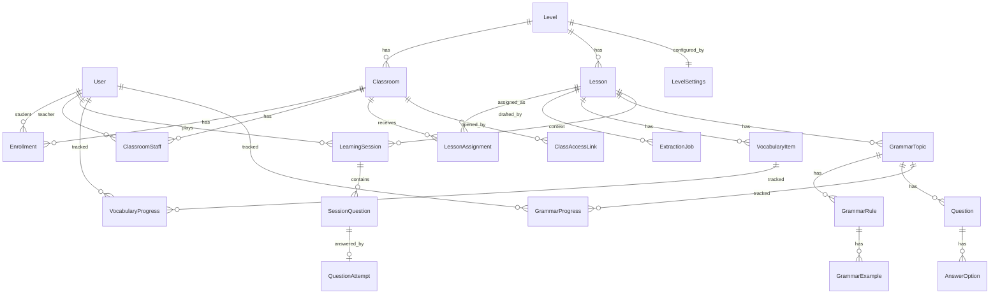

# 03 — Data Model (PostgreSQL via EF Core)

Conventions: table names plural PascalCase; `int` identity PKs; all timestamps `timestamptz` (UTC); enums stored as **string** (readable, safe against reordering); `Required` unless marked `?`.
Entities live in `BusinessObject/{FeatureGroup}/`; configuration via Fluent API in `DAL/` (no logic in entities).
**Database:** PostgreSQL on Supabase. All tables live in schema **`app`** (not exposed by Supabase's auto API) and have **RLS enabled with no policies** (defence in depth).

## 1. ERD (core)


## 2. Identity & class
**User** — `Username` (unique, case-insensitive; Young profiles get a generated internal username), `Email?`, `PasswordHash?` (null for ClassLink users), `DisplayName` (**nickname only** for children), `AvatarKey?`, `Role` {Admin, Teacher, Student}, `LoginMode` {Password, ClassLink}, `IsActive`, `MustChangePassword`, `CreatedAt`, `LastLoginAt?`.
**Level** — `Code` (unique: `kiddie`,`birdie`,`newbie`,`explore-1..4`,`pioneer-1..2`), `DisplayName`, `SortOrder`, `IsActive`, `Group` {Young, Senior}. Seeded by migration.
**LevelSettings** — `LevelId` (unique), `AccessMode` {ClassLink, Password}, `ShowPercentScore`, `PassThresholdPercent?`, `GrammarPresentation` {UsageFirst, FullRules}, `EnabledActivities` (string[]), `QuestionCount`, `OptionCount`, `StarThreshold3` (default 80), `StarThreshold2` (default 50). Seeded per the table in 07.
**Classroom** — `Name`, `LevelId`, `TermName?`, `StartDate?`, `EndDate?`, `IsArchived`, `CreatedByUserId`, `CreatedAt`. Unique `(LevelId, Name, TermName)`.
**Enrollment** — `ClassroomId`, `StudentId`, `Status` {Active, Left}, `EnrolledAt`. Unique `(ClassroomId, StudentId)`. Index `(StudentId)`.
**ClassroomStaff** — `ClassroomId`, `TeacherId`, `StaffRole` {Lead, Assistant}. Unique `(ClassroomId, TeacherId)`. *(TC-12.)*
**ClassAccessLink** — `ClassroomId`, `TokenHash` (SHA-256 of a ≥ 32-byte random token; token shown once), `CreatedAt`, `RevokedAt?`, `LastUsedAt?`. At most one non-revoked link per classroom (partial unique index). Only for classrooms whose level `AccessMode = ClassLink`.

## 3. Learning content
**Lesson** — `LevelId`, `UnitNo` (int), `UnitTitle?`, `LessonNo` (int), `Title` (e.g. "People"), `Status` {Draft, Published, Archived}, `CreatedByUserId`, `CreatedAt`, `UpdatedAt`, `PublishedAt?`. **Unique `(LevelId, UnitNo, LessonNo)`**. Index `(LevelId, Status)`.
**ExtractionJob** — `LessonId`, `Status` {Uploaded, Extracting, Draft, Approved, Discarded, Failed}, `OriginalFileName` (display only), `TempFilePath?` (deleted on approve/discard/TTL), `Sha256`, `PageCount`, `Provider`, `Model`, `DraftJson?`, `ErrorMessage?`, `CreatedByUserId`, `CreatedAt`, `CompletedAt?`. **No permanent copy of the slide file exists.**
**VocabularyItem** — `LessonId`, `Word`, `MeaningVi?`, `MeaningEn?`, `PartOfSpeech?`, `ExampleEn?`, `ExampleVi?`, `Topic?`, `ImageKey?` (Supabase object key), `ImageSha256?`, `SourcePage?`, `SortOrder`, `IsArchived`. Unique `(LessonId, lower(Word))` (non-archived). Rule: at least one of `ImageKey` / `MeaningVi` (D-08).
**GrammarTopic** — `LessonId`, `Title`, `Summary?`, `SortOrder`. *(Young group: "sentence patterns" = topic with examples and no formula.)*
**GrammarRule** — `GrammarTopicId`, `Title`, `Formula?` (optional — empty for Young group), `Explanation?`, `PitfallNote?`, `SortOrder`.
**GrammarExample** — `GrammarRuleId`, `TextEn`, `TextVi?`, `ImageKey?`, `SortOrder`.
**Question** *(authored)* — `LessonId`, `GrammarTopicId?`, `Type` {MultipleChoice, FillBlank, SentenceOrder}, `Purpose` {GuidedPractice, MiniTest}, `Prompt`, `PromptImageKey?`, `Explanation?` (required for Senior, optional for Young), `SortOrder`, `IsArchived`.
**AnswerOption** — `QuestionId`, `Text?`, `ImageKey?`, `IsCorrect`, `Position?`, `SortOrder`.
- MultipleChoice: ≥ 2 options, **exactly one** `IsCorrect` (option may be text or picture).
- FillBlank: each row = one accepted answer; ≥ 1.
- SentenceOrder: rows are tokens; `Position` = correct index (contiguous, unique).

## 4. Assignment
**LessonAssignment** — `LessonId`, `ClassroomId`, `AssignedByUserId`, `AssignedAt`, `DueAt?`. Unique `(LessonId, ClassroomId)`. Only `Published` lessons whose `Level` matches the classroom level may be assigned (service rule).

## 5. Learning history (append-mostly; never edited after completion)
**LearningSession** — `StudentId`, `LessonId`, `ClassroomId?` (context; null = self-practice), `ActivityType` {VocabLookListenRepeat, VocabListenPickPicture, VocabPictureWordMatch, VocabWordScramble, GrammarUsagePractice, GrammarGuidedPractice, GrammarMiniTest}, `Mode` {Learn, Practice, Test}, `GrammarTopicId?`, `Status` {InProgress, Completed, Abandoned}, `StartedAt`, `CompletedAt?`, `TotalQuestions`, `CorrectCount`, `ScorePercent?` (decimal(5,2), computed on complete; **always stored**, only *shown* when `ShowPercentScore`), `Stars?` (1–3, Young group), `SettingsSnapshotJson`.
Indexes: `(StudentId, StartedAt DESC)`, `(ClassroomId, LessonId)`.

**SessionQuestion** — `SessionId`, `Position`, `Skill` {Meaning, Spelling, Usage, Listening, Grammar}, `QuestionId?`, `VocabularyItemId?`, `SnapshotJson`, `Weight` (default 1).
Unique `(SessionId, Position)`. `Learn` sessions have no `SessionQuestion` rows.
`SnapshotJson` shape (server-internal, never returned whole before answering):
```json
{ "kind": "multiple-choice|typed|sentence-order",
  "prompt": "…", "imageKey": null, "speakText": null,   // speakText only for listen-type questions
  "options": [{ "key": "412", "text": "gloves" }],
  "correctKeys": ["412"],            // typed: acceptedAnswers: ["gloves"]
  "explanation": "…", "sourceVersionUpdatedAt": "2026-10-27T…Z" }
```
**QuestionAttempt** — `SessionQuestionId` (**UNIQUE**), `AnswerPayload` (selected key(s) / typed text / ordered keys), `IsCorrect`, `AnsweredAt`, `TimeSpentMs?`.

## 6. Progress aggregates (for reports and review)
**VocabularyProgress** — `StudentId`, `VocabularyItemId`, `Skill`, `CorrectCount`, `WrongCount`, `ConsecutiveCorrect`, `LastAttemptAt`, `LastWrongAt?`. **Unique** `(StudentId, VocabularyItemId, Skill)`. Index `(VocabularyItemId, WrongCount DESC)`.
**GrammarProgress** — `StudentId`, `GrammarTopicId`, `Attempts`, `BestScore`, `LastScore`, `LastAttemptAt`. Unique `(StudentId, GrammarTopicId)`.
**ReviewSchedule** *(P1)* — `StudentId`, `TargetType` {Vocabulary, GrammarTopic}, `TargetId`, `Skill?`, `DueAt`, `IntervalStep` (0..3 → 1/3/7/14 days). Unique `(StudentId, TargetType, TargetId, Skill)`.

## 7. Write paths that must be transactional
| Operation | Single transaction contains |
|---|---|
| Submit answer | insert `QuestionAttempt` (unique guard) + upsert `VocabularyProgress` |
| Complete session | compute score from attempts + set `Status/CompletedAt/ScorePercent` + upsert `GrammarProgress` (grammar) |
Upserts use `INSERT … ON CONFLICT DO UPDATE` (or `ExecuteUpdate`) to stay safe under concurrent requests.

## 8. Query hot spots (verify with `EXPLAIN` in S5-T03)
- **Weak words for a class:** join `Enrollment → VocabularyProgress → VocabularyItem`, group by item, order by `WrongCount/(CorrectCount+WrongCount)` with a minimum-attempts threshold. One query, no per-student loop (avoid N+1).
- **Student history:** `LearningSession` by `(StudentId, StartedAt DESC)`, paged.
- **Assigned lessons for student:** `Enrollment → LessonAssignment → Lesson(Published)`.

## 9. Integrity rules (enforced in Service + DB where possible)
- A lesson with sessions is never hard-deleted — archive instead. Vocabulary/questions edited after use are safe because of snapshots (D-02); deleting a used item sets `VocabularyItemId` references to remain (FK `ON DELETE RESTRICT`; use soft "archive" flag `IsArchived` on `VocabularyItem` and `Question` if deletion is requested).
- `Published` lesson edits are allowed; they affect **future** sessions only.
- Level of `LessonAssignment`'s lesson must equal the classroom's level.
- Images are referenced by `ImageKey`; deleting an item archives it, and unreferenced images are garbage-collected by a periodic job (never while a draft/snapshot references the key).
- Supabase free-plan budget: 500 MB DB / 1 GB files → ~100 KB per image ⇒ thousands of images; sessions are the main DB growth (≈ 1 KB per answered question) — fine for 4 classes.
