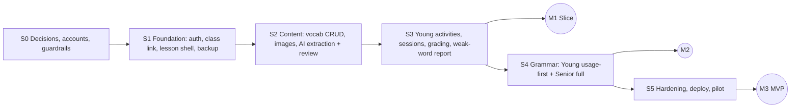

# 05 — Roadmap (v2)

**Pace:** ~2 h/day, no hard deadline → work is **ordered, not dated**. Task size: **S ≈ 2 h** (one session) · **M ≈ 5 h** (2–3 sessions) · **L ≈ 10 h** (4–6 sessions; split if you can). Totals are computed in `sprints/_estimate.md`.

## Principle: vertical slice first
Everything up to **M1** exists to make one real lesson work end-to-end: **Explore 1 · Unit 3 · Lesson 1** (8 words) for a real class. Pioneer/full-grammar features come after.

| Brainstorm | This plan | Reason |
|---|---|---|
| Layer-ordered sprints | **Slice-ordered sprints** | A real child can play something at M1 |
| Grammar CRUD early | Grammar after M1 | Not needed for the slice |
| PDF/PPTX extraction = P2 | **AI extraction is the main entry path (P0 in S2)** | Loc's decision: upload → AI draft → review |
| Same UX for all | **Young vs Senior groups** driven by `LevelSettings` | Different age needs |
| Perf tuning sprint | Reduced | < 80 students total |

## Milestones
| ID | After | Demonstrable outcome |
|---|---|---|
| **M0** | S0 | Decisions closed; Supabase + Gemini key + repo guardrails ready; demo dataset (8 words) written by hand |
| **M0.5** | S1 | Teacher can log in, create class + roster, share the class link; Supabase schema secure; backups working |
| **M1** | S3 | **Vertical slice:** upload U3-L1 PDF → approve AI draft → assign → children tap profile → 3 activities → stars + stored results → teacher sees weak words |
| **M2** | S4 | Young usage-first grammar + Senior full grammar flow |
| **M3** | S5 | Hardened, deployed, piloted with real classes |

## Dependency graph

## Highest-risk items (build test-first / spike early)
1. **S2 extraction pipeline** — only part with external uncertainty (PDF library, Gemini free-tier limits, image mapping). Spike first (S2-T11 is a 1-day spike with a go/no-go on the sample PDF). Fallback if it fails: manual vocabulary entry (already built in S2-T03/T06) — the product still works.
2. **S1-T02 Supabase exposure** — mis-configured schema/RLS could expose children's data through the public API. Verified by an automated test.
3. **S3-T03/T04 grading + idempotency** and **S1-T05 access service** — security and correctness core.
4. **Browser speech** on iOS/Android/shared computers — validated in S3-T07 on real devices before building more kids UI.

## Backlog after MVP (not scheduled)
Pronunciation scoring · audio files instead of browser voice · "Who's missing?", Memory Match, Context Challenge, Word Sorting, Missing Letters, Sentence Builder · spaced-review scheduler (`ReviewSchedule` 1/3/7/14) · bulk CSV import · duplicate lesson · XP/badges/streaks · per-level activity overrides UI · refresh tokens · multi-teacher/center support · import Units 7–8 (Pioneer 1) via the pipeline.
